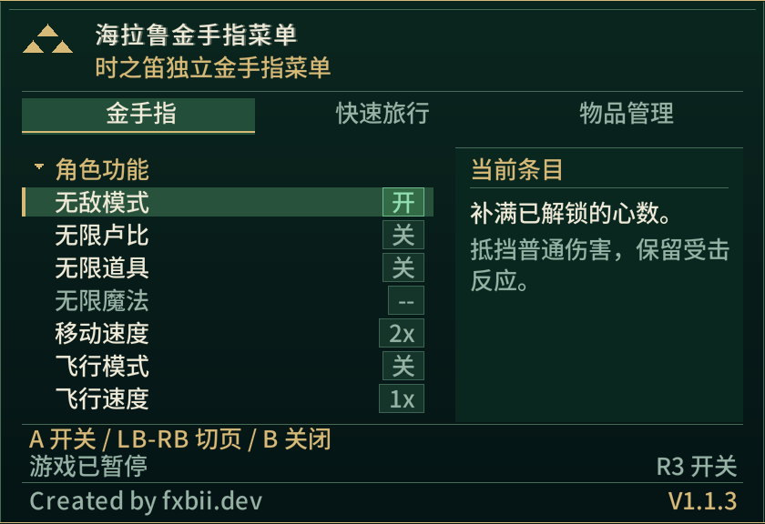
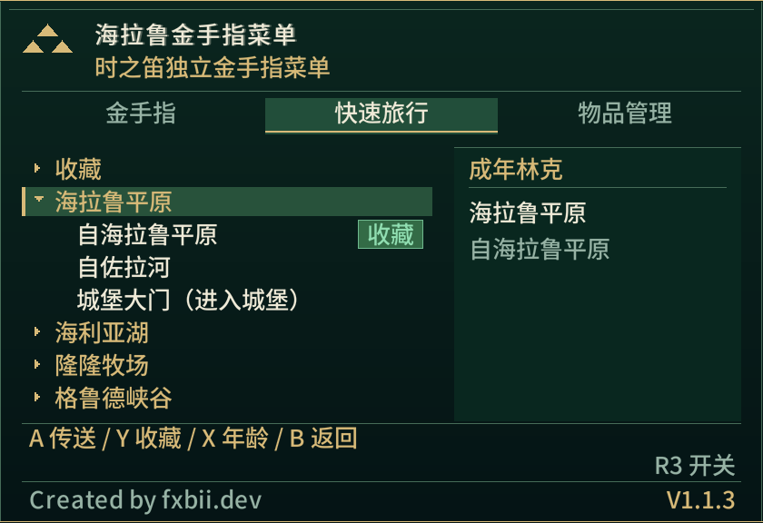

<div align="center">

# 海拉鲁金手指菜单 · 简体中文版

**Hyrule Cheat Menu — Simplified Chinese Edition**

`基于原版 v1.1.3` · `Lichii Build 177` · `Windows` · `非官方汉化`

</div>

> **原作者：fxbii.dev（GitHub [@fxbiidev](https://github.com/fxbiidev)）**
> 原仓库：<https://github.com/fxbiidev/hyrule-cheat-menu>
>
> 本仓库是原版 **v1.1.3** 的**非官方简体中文汉化版**。全部功能实现、内存逆向、界面设计、运行时代码均由原作者完成；本仓库只做**文本翻译、中文字库与版式适配**，不包含任何新的游戏逻辑，也不修改 IPS 补丁。

---

## 目录

- [这是什么](#这是什么)
- [汉化说明](#汉化说明)
- [仓库内容](#仓库内容)
- [功能一览](#功能一览)
- [兼容性](#兼容性)
- [安装](#安装)
- [操作](#操作)
- [与原版的差异](#与原版的差异)
- [常见问题](#常见问题)
- [免责声明](#免责声明)
- [授权与致谢](#授权与致谢)

---

## 这是什么

Hyrule Cheat Menu 是一个运行在《塞尔达传说：时之笛》重制版（OOTR）里的 ExeFS 附加模块。游戏过程中按 **R3** 即可呼出菜单，界面分为 **金手指 / 快速旅行 / 物品管理** 三个页签。菜单打开时游戏进入原生暂停状态，模块不注入常驻 HUD、不上报遥测、不联网、不含外部修改器进程。

汉化版保留了原版的翡翠绿 + 金色配色、右侧说明卡片、选中高亮条与状态提示，并把全部界面文本译为简体中文。

<p align="center">
  
  
</p>

> 上图是按源码坐标 1:1 复现的版面预览（840×576，与实机画布同尺寸），直接使用设备上运行的那份点阵字模渲染。

---

## 汉化说明

| 项目 | 说明 |
|---|---|
| 汉化模型 | **DeepSeek-V4.1-Flash** |
| 汉化范围 | 界面标题、页签、功能名、状态文字、说明文案、物品名、地点名、错误提示 |
| 翻译条目 | 214 个快速旅行目的地、37 个区域分组、21 件物品、5 个物品分类、全部功能与状态提示 |
| 字库 | 由源码自动扫描全部中文字符烘焙生成，共 576 个汉字 + 95 个西文字形，无缺字 |
| 校对 | 译名统一、术语一致；版式按像素核对，预览与实机使用同一份字模 |

文本翻译、字库烘焙脚本、渲染层改造均由 **DeepSeek-V4.1-Flash** 完成；汉化者负责需求取舍与实机验收。

原版的 5×7 硬编码英文点阵无法绘制汉字，因此渲染层改成了 UTF-8 感知的 8bpp 覆盖度字模 + Alpha 混合，并新增中文字宽计算与按像素折行（收尾标点不落行首）。这部分改动只影响绘制，不触碰任何游戏数据。

---

## 仓库内容

```text
.
├── README.md                          ← 本文件
├── Hyrule-Cheat-Menu-v1.1.3-zh_CN.zip  ← 直接安装这个
├── Hyrule-Cheat-Menu-v1.1.3-zh_CN/     ← 解压后的目录，与 zip 内容一致
├── Fast-Travel-LICENSE.txt
├── SourceHanSans-OFL.txt
├── preview-cheats.png
└── preview-travel.png

```

源码与构建脚本请前往[原仓库](https://github.com/fxbiidev/hyrule-cheat-menu)，本仓库不重复分发。

---

## 功能一览

| 功能 | 行为 |
|---|---|
| 无敌模式 | 补满已解锁的心数，抵挡普通伤害并保留受击反应 |
| 无限卢比 | 填满当前钱包并维持容量上限 |
| 无限道具 | 补充已拥有的箭、炸弹、炸弹鼠与德库种子等；排除瓶子、豆子、钥匙与剧情道具 |
| 无限魔法 | 补充已有的魔法槽，未解锁魔法前不可用 |
| 移动速度 | 1× / 1.5× / 2× / 3×，作用于走、跑、游、爬 |
| 飞行模式 | 相机相对水平移动，垂直升降，沿用林克原生碰撞控制器 |
| 飞行速度 | 独立的 1× / 1.5× / 2× / 3× / 5× / 10× 六档 |
| 穿墙模式 | 贴地穿墙并保留地板支撑；配合飞行可穿透墙、地板与天花板 |
| 一击必杀 | 仅对白名单内的普通敌人生效，并校验伤害来源确为当前林克 |
| 伤害倍率 | 1× / 1.5× / 2× / 3×；一击必杀开启时优先，倍率仍保留 |
| 自由相机 | 脱离游戏视角，双摇杆平移旋转，扳机升降，支持 R3+B 紧急退出 |
| 物品管理 | 21 件原生物品的添加 / 移除与数量调整，含年龄与容量校验 |
| 快速旅行 | 214 个目的地、37 个可折叠分组，含年龄切换、收藏与返回上一地点 |

不可用的条目会保持可读并给出原因说明。各开关相互独立，普通速度与飞行速度分别保存。

---

## 兼容性

| 项目 | 目标 |
|---|---|
| 模拟器 | Lichii Build 177（Windows） |
| 库更新标签 | 2.0.0 |
| Title ID | `0400486024DEC000` |
| Main Build ID | `E0F3CCFAF50065AE4EA01EB5AEB13B1A45DA3348` |

IPS 补丁文件名按 Build ID 决定是否加载，因此**与本汉化版捆绑的 IPS 文件必须和 `subsdk8` 一起使用**，不可只替换其中一个。

其他可执行文件版本、区域、分支以及任意 hook mod 未经测试。若已安装其他使用 `subsdk8` 的 mod，会与本项目冲突。

> 汉化版使用的 IPS 补丁与官方 v1.1.3 发布包**逐字节一致**，游戏侧 hook 桩没有任何改动——所有汉化都发生在模块内部。

---

## 安装

1. 关闭游戏，并先备份存档（见下方「备份存档」）。
2. 在 Lichii 中右键游戏，选择 **Open Mod Data Location**。
3. 把 `Hyrule-Cheat-Menu-v1.1.3-zh_CN.zip` 解压到该目录。更新时请**整体替换**整个 mod 文件夹。最终结构应为：

```text
<游戏的 mod 数据目录>/
└── Hyrule-Cheat-Menu/
    ├── exefs/
    │   ├── subsdk8
    │   └── E0F3CCFAF50065AE4EA01EB5AEB13B1A45DA3348.ips
    ├── third_party/
    │   ├── Fast-Travel-LICENSE.txt
    │   └── SourceHanSans-OFL.txt
    └── 使用说明.md
```

4. 如有需要，在游戏属性里启用该附加模块，启动游戏并读取存档。
5. 正常游戏过程中按 **R3** 呼出菜单，无需额外程序或后台服务。

注意不要出现多套嵌的 `Hyrule-Cheat-Menu/Hyrule-Cheat-Menu` 目录。

### 更新与卸载

关闭游戏后替换整个 `Hyrule-Cheat-Menu` 文件夹即可。偏好设置单独存放在模拟器的 SD 卡目录下，替换 mod 不会丢失。

卸载时删除该 mod 文件夹；游戏本体文件不会被改写。若要一并清除偏好设置，可删除 Lichii 用户目录下的 `sdmc/Hyrule-Cheat-Menu/`。

### 备份存档

关闭游戏，使用 Lichii 的 **Open Save Data Location** 打开存档目录，把整个目录复制到一个带日期的文件夹。**只在游戏关闭时还原存档。**

---

## 操作

> 下表按 Lichii 配置后的**逻辑输入**列出，物理按键标签可能不同。

| 输入 | 作用 |
|---|---|
| R3 | 打开 / 关闭菜单 |
| 十字键 上 / 下 | 选择条目，长按可连续滚动 |
| A | 开关、展开、选择或确认 |
| B | 取消确认；折叠分类；在折叠的根条目上关闭菜单 |
| 十字键 左 / 右 | 调整速度或伤害倍率；展开 / 折叠分类；草拟物品数量 |
| LB / RB | 上一个 / 下一个页签：金手指、快速旅行、物品管理 |
| X（快速旅行） | 切换幼年 / 成年目的地列表 |
| Y（目的地） | 添加 / 取消收藏 |
| A（可编辑物品） | 添加物品 / 移除物品，或确认草拟的数量 |
| X（可编辑物品） | 打开「补满至上限」确认 |
| Y（可编辑物品） | 打开「移除 / 清零」确认 |
| 左摇杆（飞行） | 相对相机的水平飞行 |
| 右摇杆（飞行） | 正常视角控制 |
| 左摇杆（自由相机） | 平移视角 |
| 右摇杆（自由相机） | 旋转视角 |
| RT / ZR | 飞行或自由相机上升 |
| LT / ZL | 飞行或自由相机下降 |
| R3 + B（自由相机） | 紧急退出视角 |

菜单打开期间，导航输入会被菜单消费，不会传回游戏。

---

## 与原版的差异

| 方面 | 原版 v1.1.3 | 本汉化版 |
|---|---|---|
| 界面语言 | 英文 | 简体中文（含物品名、地点名、状态提示） |
| 字库 | 5×7 硬编码英文点阵 | 思源黑体 26px 8bpp 灰度点阵（2 倍超采样烘焙） |
| 绘制画布 | 420×288 | 840×576（文字 1:1 输出，不再小字放大） |
| 线条与形状 | 像素块 | 1 像素细线、平滑三角形、带边框的状态框 |
| 列表行数 | 9 行 | 8 行（行距加宽，状态框有足够内边距） |
| 游戏逻辑 | — | **零改动** |
| IPS 补丁 | — | **与官方逐字节一致** |

字库使用 [思源黑体 Source Han Sans SC](https://github.com/adobe-fonts/source-han-sans) Medium 字重，按 [SIL Open Font License 1.1](docs/SourceHanSans-OFL.txt) 授权，可自由分发，许可文件已随包附带。

---

## 常见问题

**按 R3 没反应**
检查游戏更新版本与 Build ID、附加模块是否启用、目录是否多套了一层、玩家 1 手柄映射是否正确，以及是否与其他 `subsdk8` mod 冲突。对话、过场、原生菜单与加载过程中菜单会被主动屏蔽。

**条目显示为灰色**
阅读右侧说明卡片。魔法需要先解锁魔法槽；飞行与穿墙需要可靠的落脚点与场景支持。函数签名不匹配时对应功能会被禁用。

**传送被拒绝**
站到稳定地面或游在已识别的场景里，等普通游戏恢复后再试。部分水下到达状态会拒绝原生事件，先游开或上浮。超时后模组会结束本次操作，请等原生对话、过场或加载结束后再试。

**物品编辑被拒绝**
检查林克的年龄、原生容量、共用槽位规则，并确认「无限道具」已关闭。编辑前不需要事先获得该物品。若出现不确定状态，请重新读取一次正常存档再编辑。

**存档安全**
使用移动类金手指前请务必备份存档。飞行、穿墙、自由相机属于修改角色状态的操作，可能导致异常位置或卡死；一击必杀与伤害倍率只作用于白名单普通敌人，不影响首领与剧情角色。

**日志**
在 Lichii 的本地日志里搜索 `[hyrule]` 可查看模组自身的诊断输出，不会上传任何内容。

---

## 免责声明

**请在使用前完整阅读本节。**

1. **非官方作品。** 本项目由第三方爱好者汉化，与任天堂（Nintendo）、Lichii 模拟器团队以及原作者 fxbii.dev **均无隶属或合作关系**。原作者未参与本汉化版的制作，也不对其承担任何责任。
2. **不提供游戏本体。** 本仓库不包含、不提供《塞尔达传说：时之笛》的游戏本体、ROM、密钥、存档或任何提取的游戏资源。使用本项目需要你自行合法拥有该游戏。
3. **仅供个人学习与研究。** 请在**单机、离线、个人存档**环境下使用，**禁止任何形式的商业用途**，包括但不限于售卖、捆绑销售、付费下载、直播打赏式分发或以本项目牟利。
4. **风险自负。** 修改游戏内存与角色状态可能导致**存档异常、任务状态错乱、游戏崩溃或进度丢失**。使用前请务必备份存档；因使用本汉化版造成的任何直接或间接损失，由使用者自行承担。
5. **不保证适用性。** 本项目仅针对上文列出的模拟器与游戏版本测试，其他版本、区域或分支不保证可用。作者与汉化者均不对兼容性问题提供担保。
6. **版权归属。** 《塞尔达传说》及相关角色、名称、素材的版权归任天堂所有。若权利人认为本项目侵犯其权益，请联系删除，本项目将立即停止分发。
7. **尊重原作者。** 本汉化版基于原作者的发布包制作，未获得原作者对二次分发的明示授权。**若原作者提出异议，本仓库将立即下架并删除全部内容。**

---

## 授权与致谢

**原作者：fxbii.dev** — 全部功能实现、内存逆向、菜单图形与运行时代码。原仓库：[fxbiidev/hyrule-cheat-menu](https://github.com/fxbiidev/hyrule-cheat-menu)。原版 README 明确说明「未对作者原始代码授予额外通用开源许可」，本汉化版按原发布形式分发，未改动游戏逻辑与 IPS 补丁。

**快速旅行目的地数据** 来自 Clay Mullis 的 Fast Travel 参考项目，遵循 [MIT 许可](docs/Fast-Travel-LICENSE.txt)。

**中文字库** 使用 [思源黑体 Source Han Sans SC](https://github.com/adobe-fonts/source-han-sans)，遵循 [SIL Open Font License 1.1](docs/SourceHanSans-OFL.txt)。

**汉化** 由 **DeepSeek-V4.1-Flash** 辅助完成（文本翻译、字库烘焙、渲染层改造），译名与版式经人工校对。

Nintendo、The Legend of Zelda 及相关商标归其各自所有者。本项目为非官方 mod，与任天堂无关。
